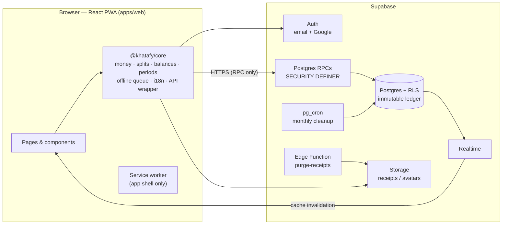

<div align="center">
# Khatafy
 
### Shared-expense diary for people who live together — *Saath Raho. Hisab Saaf Rakho.*
 
Track shared rent, groceries and bills in a flat, room or hostel. Split fairly, settle up, close the books, and always know who owes whom — down to the paisa.
 
**React 19 · TypeScript · Vite · Supabase (Postgres + RLS) · PWA · English + Hindi**
 
</div>
<p align="center">
  
</p>
---
 
## Table of contents
 
1. [Overview](#1-overview)
2. [Highlights](#2-highlights)
3. [Screenshots](#3-screenshots)
4. [How the period-close system works](#4-how-the-period-close-system-works)
5. [Architecture](#5-architecture)
6. [Tech stack](#6-tech-stack)
7. [Engineering decisions](#7-engineering-decisions)
8. [Security & privacy](#8-security--privacy)
9. [Testing](#9-testing)
10. [Project at a glance](#10-project-at-a-glance)
11. [Getting started](#11-getting-started)
12. [Deployment (Vercel + Supabase)](#12-deployment-vercel--supabase)
13. [Configuration reference](#13-configuration-reference)
14. [Repository layout](#14-repository-layout)
15. [Known limitations & roadmap](#15-known-limitations--roadmap)
16. [Version history](#16-version-history)
17. [Author](#17-author)
---
 
## 1. Overview
 
**The problem.** Roommates share money all month — rent, groceries, gas, internet — and lose track in WhatsApp chats and notebooks. Arguments start at month-end: *who paid what, who owes whom, was that already settled?*
 
**The solution.** Khatafy is a mobile-first web app (installable as a PWA) that gives every group one trusted ledger:
 
- anyone adds an expense they paid and chooses how to split it,
- balances and "who pays whom" suggestions update instantly,
- payments are recorded and **confirmed by the receiver**,
- an admin periodically **closes the books**, saving a permanent summary, and any unpaid money is carried forward and shown separately from new spending.
It is built like a real product rather than a demo: strict database-level security, immutable financial records, an offline-capable client, a bilingual UI (English / Hindi), automated tests against a real PostgreSQL, and a privacy-first admin panel.
 
---
 
## 2. Highlights
 
| | |
|---|---|
| 💸 **Exact money** | All amounts are integer **paise**; no floating point anywhere. Split remainders are distributed deterministically, and the TypeScript and SQL implementations are proven identical by a parity test. |
| 🧾 **Flexible splits** | Equal, exact-amount and percentage splits; receipts (photo / PDF); edit history; cancel (void) with a reason. |
| 🔒 **Close & period tracking** | One-click "Close the books" with preview, per-close summary and PDF. Earlier unpaid dues are kept **separate** from the current period. |
| 🏠 **Clear Home screen** | *My balance*, *Current period* and *Last closed period* cards show exactly what matters. |
| 👥 **Safe collaboration** | Invite code/link → **admin approval**; roles (Admin / Member); the group creator cannot be removed. |
| 🤝 **Trustworthy payments** | A payment counts only after the receiver confirms it. Reminders for pending dues. |
| 📴 **Offline-first entry** | New expenses can be written offline and sync automatically — idempotency keys prevent duplicates. |
| 🌐 **Bilingual** | Full English + Hindi UI. A test fails if any text or database error code lacks a translation. |
| 📱 **PWA** | Installable on Android / iOS / desktop; responsive from 360 px phones to wide desktops. |
| 🛡️ **Privacy-safe admin panel** | Platform admins see counts and technical data only — never names, amounts, notes or receipts. |
| 🧹 **Self-cleaning data** | A monthly job keeps the last 12 months and deletes older records, **carrying unpaid balances forward**. |
 
Also included: shopping list, notice board, activity log, in-app notifications, budgets with alerts, per-person statements, month-wise **and** period-wise reports, PDF export, Google sign-in (optional), email verification and password reset.
 
---
 
## 3. Screenshots
 
**Desktop — Home** (balance, current period, last closed period)
 

**Desktop — Settle & close** (current period, close form, settled history)
 

*(Mobile screens are at the top of this page; the Hindi UI is the right-most phone.)*
 
---
 
## 4. How the period-close system works
 
A **period** is the time between two closes. The one still running is the **current (open) period**.
 
```
  ── close #1 ────────────── close #2 ────────────── now ──▶
       Period 1 (closed)       Period 2 (closed)    Current period (open)
```
 
**Closing (admin).**
1. Pick a date → see a **preview** → confirm once. There is no waiting window.
2. A **summary** is stored: total spent, who paid / owed what, payments, and the dues carried forward.
3. Closed expenses leave the Expenses list and become **read-only**.
4. "Close up to today" cuts at the *moment of closing*, so expenses added later that day belong to the next period.
**Earlier dues vs. current record — never mixed.**
- Unpaid money from a closed period appears in its own **Earlier dues** card: who pays whom, for which period.
- New expenses only affect the **current period**.
- A payment made after a close first settles earlier dues between the same two people; the rest counts for the current period.
**Where it shows.** Home cards · Close & history (current record, earlier dues, per-close cards with PDF) · Balances (*Current / By month / Period*) · Reports · Statement.
 
**Retention.** On the last day of each month, a database job keeps only the last **12 months** of history and deletes older records, while preserving every unpaid balance.
 
**Server-enforced rules.** Expense and payment timestamps are always "now" (cannot be back-dated); a member can only add expenses they paid; an expense can be edited within 60 minutes, otherwise it can be cancelled (void) but never silently altered.
 
---
 
## 5. Architecture
 

 
**Key idea:** the client never reads or writes tables directly. Every operation is a **Postgres function** that checks `auth.uid()`, group membership and role, writes an audit row and returns JSON. Row-Level Security remains as a second line of defence.
 
---
 
## 6. Tech stack
 
| Layer | Technology |
|---|---|
| Frontend | React 19, TypeScript, Vite, hand-written responsive CSS (light / dark themes) |
| Shared logic | `@khatafy/core` — a framework-free TypeScript package (money, splits, balances, periods, offline queue, i18n, typed API client) |
| Backend | Supabase: PostgreSQL, Row-Level Security, SECURITY DEFINER RPCs, Auth, Storage, Realtime, `pg_cron`, Edge Functions (Deno) |
| PWA | Web manifest, service worker (app-shell cache, network-first), offline draft queue |
| Testing | `node:test` + `tsx`, real PostgreSQL integration tests, Playwright (Chromium) browser journeys |
| Hosting | Vercel (frontend, with security headers) + Supabase (backend) |
 
---
 
## 7. Engineering decisions
 
- **Integer paise, one algorithm, two languages.** `compute_splits` (SQL) and `computeSplits` (TS) implement the same remainder-distribution rule; `parity.test.ts` proves they agree, so the preview in the browser always matches what the database stores.
- **RPC-only data access.** A small, auditable API surface of 80+ database functions instead of ad-hoc queries. Internal `kh_*` helpers are revoked from clients.
- **Immutable ledger.** Expenses and payments are never hard-deleted (trigger-enforced). Edits create a new split *version* plus a revision row; voids keep the record.
- **Concurrency safety.** Optimistic `expected_version` on edit/void, idempotency keys on create expense / record payment (safe offline retries), rate limits in Postgres.
- **Balance definition.** `paid − share + settlements paid − settlements received`, counting **confirmed** payments only; month boundaries use the group's time zone.
- **Period model.** Each close stores an exact cut timestamp and a JSON summary, so any past period can be re-rendered, exported or audited later without recomputation drift.
- **Offline without data leaks.** The service worker caches the app shell only — never API responses. Drafts queue locally and sync with idempotency keys.
- **i18n as a contract.** One dictionary per concern; a test fails if a key used in the UI, or an error code raised by SQL, is missing English *or* Hindi.
- **PDF without a heavy library.** Print stylesheets + `window.print()` produce clean, selectable PDFs in both languages.
- **Responsive audit as a test.** A browser test opens ~28 screens at 360 / 768 / 1280 px in English and Hindi and fails on horizontal scroll, overlapping text or content off-screen.
---
 
## 8. Security & privacy
 
- **RLS on every table** plus RPC-level authorization (membership + role) on every call.
- **No `service_role` key in the frontend** — the browser only ever holds the public anon key.
- **Hardened functions:** `SECURITY DEFINER` with `set search_path = ''`; execute rights revoked from `public`/`anon` and granted to `authenticated` per function.
- **Invites:** codes are shown once and stored only as a hash; joining needs admin approval.
- **Privacy by design:** phone numbers visible only to their owner; downloadable data excludes internal IDs (PDF only); account deletion anonymises history ("Deleted user").
- **Admin panel (`/admin`)** — platform admins can see *counts and technical metadata only*. They can archive/restore a group (reason required), post maintenance notices and read the audit log. Every admin action is logged. They **cannot** see names, emails, expenses, amounts, notes, receipts or payments.
- **Headers:** strict CSP, HSTS, `X-Frame-Options: DENY`, `nosniff`, restrictive `Permissions-Policy` (see `apps/web/vercel.json`).
- **Compliance posture:** Terms and Privacy pages are drafted with India's DPDP Act 2023 in mind. *They are template-quality and must be reviewed by a lawyer before a public launch.*
More: [`SECURITY_AUDIT.md`](SECURITY_AUDIT.md) · [`docs/security-checklist.md`](docs/security-checklist.md) · [`docs/privacy-notes.md`](docs/privacy-notes.md)
 
---
 
## 9. Testing
 
```bash
npm run typecheck
npm run test:core     # unit: paise math, splits, settlements, periods, offline queue, i18n completeness
npm run test:db       # integration on real PostgreSQL: RLS, roles, concurrency, close/period logic, privacy, SQL↔TS parity
npm run test:e2e      # Chromium journeys: auth → group → invite → expenses → payments → close → responsive audit
npm run web:build     # production build
```
 
| Suite | What it proves |
|---|---|
| **Core (≈17 tests)** | Money/split correctness, balance maths, period builder, offline queue, every UI key and DB error code has EN + HI text |
| **Database (≈49 + 3 parity)** | Migrations apply cleanly; RLS blocks outsiders; role rules; concurrent writes; immutability; close boundaries and period reports; privacy of the admin panel |
| **Browser (≈18 journeys)** | Real user flows in Chromium, English and Hindi, plus the 360/768/1280 px layout audit |
 
`test:db` and `test:e2e` need a local PostgreSQL (`PGHOST`, `PGPORT`, `PGUSER`; default `localhost:54329`, user `postgres`) and, once, `npx playwright install chromium`. Set `E2E_SHOTS=<folder>` to save screenshots from the layout audit.
 
---
 
## 10. Project at a glance
 
| | |
|---|---|
| Application code | ≈ 13,000 lines of TypeScript / TSX / SQL |
| Automated tests | ≈ 2,000 lines, ≈ 85 tests across three layers |
| Database | ≈ 25 tables, RLS policies, 80+ RPC functions, 21 numbered migrations |
| Screens | 18 page modules, ~28 routes, English + Hindi |
| Client dependencies | 3 runtime libraries (`react`, `react-dom`, `@supabase/supabase-js`) |
 
---
 
## 11. Getting started
 
**Prerequisites:** Node.js ≥ 20, a free [Supabase](https://supabase.com) project.
 
```bash
git clone <your-repo-url> khatafy && cd khatafy
npm install
cp apps/web/.env.example apps/web/.env      # then fill VITE_SUPABASE_URL and VITE_SUPABASE_ANON_KEY
npm run web:dev                             # http://localhost:5173
```
 
**One-time database setup**
1. Supabase → **SQL Editor** → paste and run `supabase/khatafy_all_in_one.sql` (all migrations in one file; new project only).
2. Supabase → Integrations → **Cron** → enable `pg_cron` (monthly cleanup). If the script printed *"pg_cron is not enabled"*, enable it and re-run `supabase/migrations/0016_close_no_delete_monthly_cleanup.sql`.
3. Supabase → **Authentication → URL Configuration**: set *Site URL* and add `/auth/callback` and `/reset-password` to *Redirect URLs* (production and `http://localhost:5173`).
4. Authentication → Providers → Email: keep **Confirm email** on. Before a public launch, configure a custom **SMTP** provider (the default sender is heavily rate-limited) and paste the HTML from `supabase/email-templates/`.
5. *(Optional)* Receipt-file cleanup: deploy `supabase/functions/purge-receipts` and schedule it daily (see the file header for the `CRON_SECRET` steps).
6. *(Optional)* First platform admin — run once in the SQL Editor:
```sql
   insert into public.platform_admins(user_id)
   select id from auth.users where email = 'YOU@example.com';
```
 
If you change any SQL, regenerate the bundle with `npm run db:bundle`.
 
---
 
## 12. Deployment (Vercel + Supabase)
 
| Vercel setting | Value |
|---|---|
| Root Directory | `apps/web` |
| Install Command | `cd ../.. && npm install` |
| Build Command | `npm run build` |
| Output Directory | `dist` |
| Environment Variables | `VITE_SUPABASE_URL`, `VITE_SUPABASE_ANON_KEY` (+ optional ones below) |
 
SPA rewrites and security headers ship in `apps/web/vercel.json`. Netlify and Cloudflare Pages also work (they need an "all routes → index.html" rewrite).
 
**Updating production:** commit and **push to the production branch** — Vercel deploys automatically. Uploading a zip alone does not trigger a deploy.
 
**If auto-deploy does not start:** check *Settings → Git* (repository connected), the *Production Branch*, an empty *Ignored Build Step*, the Vercel GitHub-app access to the repo, and the build log in the *Deployments* tab. After a release, hard-refresh (or reopen the installed app) so the service worker picks up the new build.
 
**Installing on a phone:** Chrome → menu → *Install app*; iPhone: Safari → Share → *Add to Home Screen*.
 
---
 
## 13. Configuration reference
 
`apps/web/.env` (template: `apps/web/.env.example`)
 
| Variable | Required | Purpose |
|---|---|---|
| `VITE_SUPABASE_URL` | ✅ | Supabase project URL |
| `VITE_SUPABASE_ANON_KEY` | ✅ | Public anon / publishable key (**never** the `service_role` key) |
| `VITE_SUPPORT_EMAIL` | optional | Address behind "Write to us" in Help |
| `VITE_ENABLE_GOOGLE` | optional | `false` hides the Google sign-in button |
| `VITE_COMPANY_NAME`, `VITE_COMPANY_ADDRESS`, `VITE_GRIEVANCE_OFFICER`, `VITE_JURISDICTION_CITY` | before launch | Shown on the Terms / Privacy pages |
 
**Migrations** live in `supabase/migrations/` (numbered `0001`–`0022`; `0015` intentionally absent). A new project runs only the all-in-one file; an existing project runs only the migrations it has not yet applied, in order. Highlights: `0003` expenses · `0004` payments ledger · `0009–0010` role model · `0011` admin panel · `0012` security hardening · `0016` close + monthly cleanup · `0018` earlier-vs-current balances · `0021–0022` period overview and period-wise reports.
 
---
 
## 14. Repository layout
 
```
apps/web/                  React app
  src/pages/               Screens (dashboard, close, money, reports, statement, diary, members, …)
  src/components/          UI kit, app shell, period picker, earlier-dues card, share table
  src/lib/                 auth, group context, router, i18n, realtime, drafts, theme, Supabase client
  public/                  PWA manifest, service worker, icons, onboarding images
  e2e/                     Browser tests + local mock server
  vercel.json              SPA rewrites + security headers
packages/core/             Framework-free shared logic + unit tests
supabase/
  migrations/              Numbered SQL migrations
  khatafy_all_in_one.sql   Generated bundle of all migrations
  functions/purge-receipts Edge Function that deletes receipt files after cleanup
  email-templates/         Branded auth email HTML
  tests/                   PostgreSQL integration + parity tests
docs/                      architecture, security, privacy, backup/restore, launch checklist, screenshots
```
 
---
 
## 15. Known limitations & roadmap
 
**Being upfront about what has and has not been verified**
- Automated tests run against a real local PostgreSQL and a Chromium browser. The browser suite uses a mock server in place of `@supabase/supabase-js`, so **flows that depend on live Supabase services** — email delivery, Google OAuth, Storage uploads, Realtime — still need a manual smoke test on a real project (checklist: [`docs/launch-checklist.md`](docs/launch-checklist.md)).
- Run `npm install && npm run typecheck && npm run web:build` on your own machine before deploying.
- Privacy Policy and Terms are templates, not legal advice.
**Not included (by design or not yet)**
- Native Android/iOS apps — the PWA covers phones.
- Push notifications outside the app (in-app notifications and Realtime exist).
- Bank/UPI verification — payments rely on **manual receiver confirmation** on purpose.
- Budgets are calendar-month based (not period based).
**Ideas for next steps:** push notifications via an Edge Function, UPI deep links, receipt OCR, scheduled reminders, period-based budgets.
 
---
 
## 16. Version history
 
| Version | Highlights |
|---|---|
| **1.9.x** | Responsive CSS overhaul (phones → desktop), compact mobile layout, side-by-side period cards on Home, period-wise Reports / Balances / Statement |
| 1.8 | Home: My balance + Current period + Last closed period; restructured Close & history |
| 1.7.x | Earlier dues shown separately from current record; close cuts at the moment of closing; timestamps always "now" |
| 1.6.x | Close without deleting data, per-close summaries and PDFs, 12-month monthly cleanup; members add only expenses they paid |
| 1.5.x | Cleaner screens, duplicate data removed, Balances + Payments merged |
| 1.4 | Simplified roles (Admin / Member); creator-only admin removal |
| 1.2 | PDF-only exports, person-wise statements, UX cleanups |
| 1.1 | Notification management, per-person shares, profile menu, Help & FAQs, onboarding, admin panel, 60-minute edit window |
| 1.0 | First release: groups, expenses, payments, reports, PWA |
 
---
 
## 17. Author
 
**[Your Name]** — [LinkedIn](https://www.linkedin.com/in/your-profile) · [GitHub](https://github.com/your-username) · [you@example.com](mailto:you@example.com)
 
*Built end-to-end: product design, database schema and security model, API layer, responsive UI, PWA/offline behaviour, bilingual content, automated tests and deployment.*
